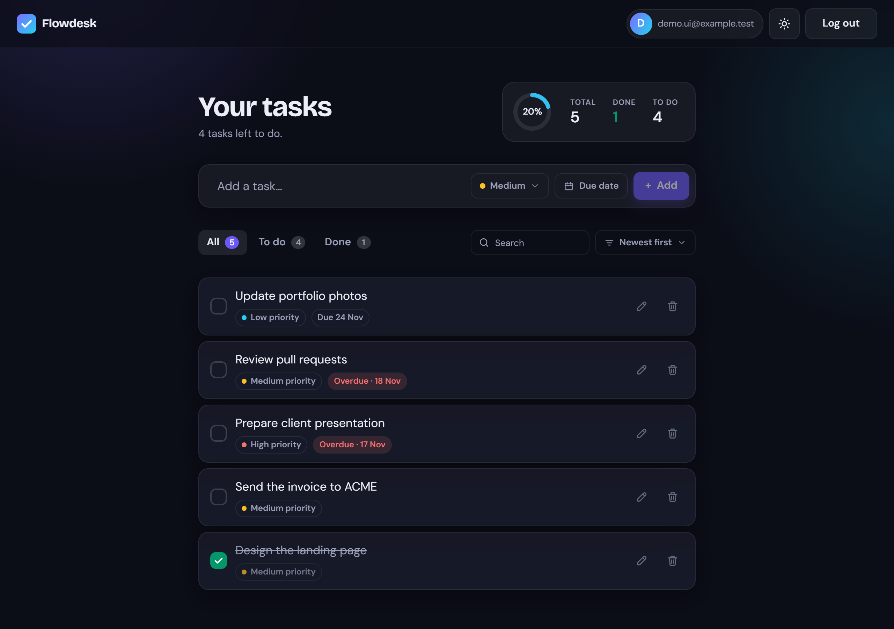
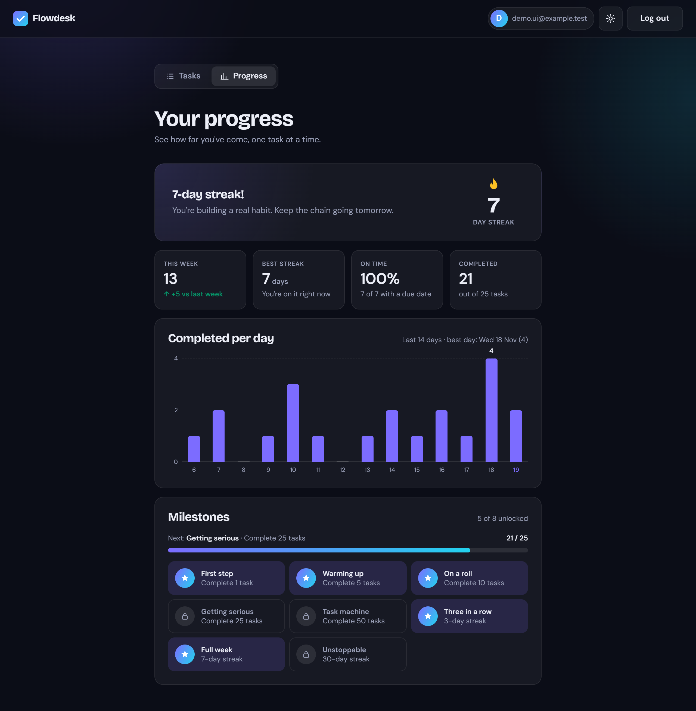
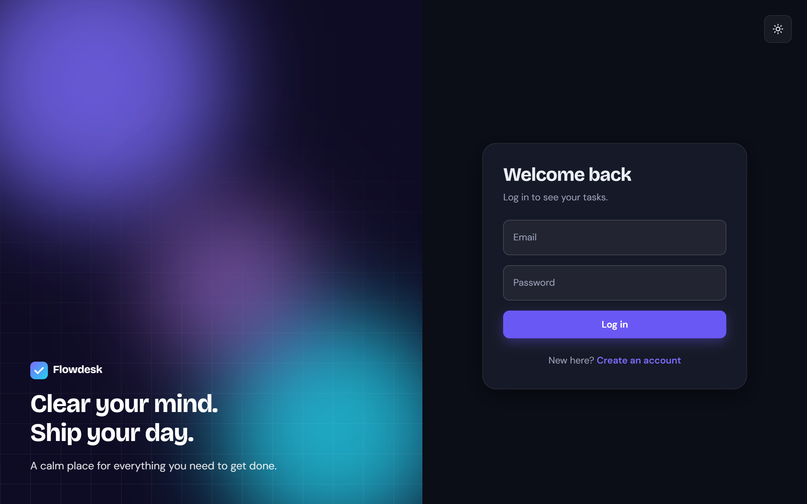
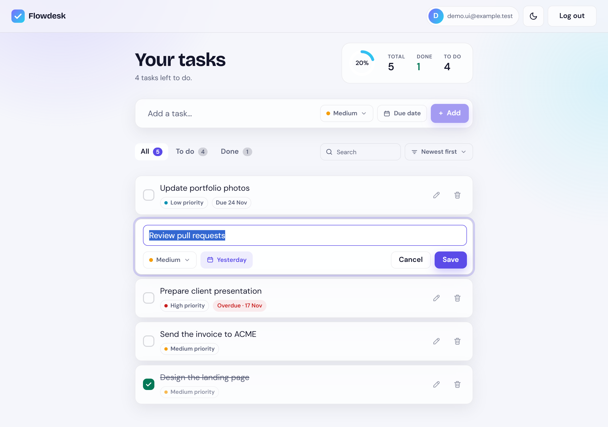
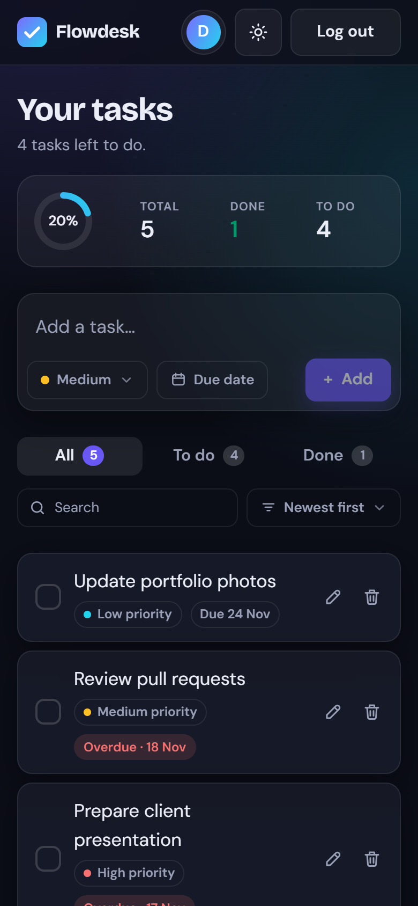
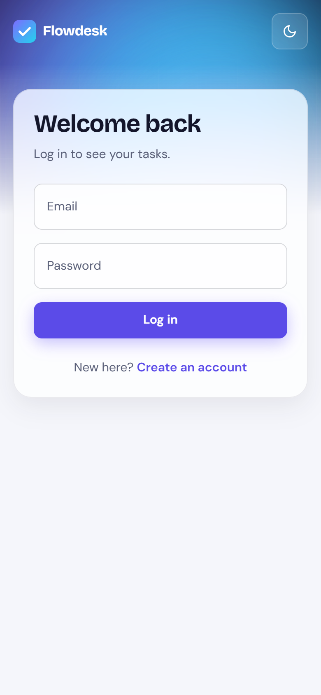

# Flowdesk — Full-stack Task Manager

[](https://github.com/molkaAgrebi/task-manager/actions/workflows/ci.yml)

A secure, responsive task manager built with **React**, **Node.js / Express**, **PostgreSQL** and **Docker**.
Each user has a private account and can create, edit, prioritise, schedule, search and complete their tasks.

### 🔗 [Live demo](https://task-manager-client-4w1h.onrender.com)

Try it without signing up:

| Email | Password |
| --- | --- |
| `demo@flowdesk.demo` | `demo-flowdesk-2026` |

> Hosted on Render's free plan: if nobody has used the API for a while, the first request
> can take about 30–50 seconds while the server wakes up.



---

## Features

- **Accounts**: sign up and log in with email and password (passwords hashed with bcrypt, sessions with JWT).
- **Tasks**: add, edit inline, check off and delete (with a confirmation step).
- **Priority and due dates**: high / medium / low, plus "Overdue", "Due today" and "Due tomorrow" badges.
- **Find things fast**: filters (All / To do / Done), live search, and sorting by date, due date, priority or title.
- **Progress at a glance**: a progress ring and counters on the task list.
- **Progress page for motivation**: daily streak, a message adapted to the user's situation, this week
  vs last week, on-time rate, a 14-day bar chart, and milestones to unlock.
- **Polished UI**: dark and light themes (choice remembered), glassmorphism, micro-animations,
  skeleton loading, toast notifications, and a friendly empty state.
- **Responsive and accessible**: works from 360 px phones to desktops, keyboard focus is always visible,
  ARIA labels on controls, and animations are disabled when the OS asks for reduced motion.

## Screenshots



| Login | Light theme + inline editing |
| --- | --- |
|  |  |

| Mobile (dark) | Mobile login (light) |
| --- | --- |
|  |  |

## Tech stack

| Layer | Technologies |
| --- | --- |
| Front end | React 19, Vite, plain CSS (custom properties for theming) |
| Back end | Node.js 22, Express 5, `pg`, bcrypt, jsonwebtoken |
| Security | helmet, express-rate-limit, CORS allow-list, input validation |
| Database | PostgreSQL (17 in Docker) |
| Tests | Jest + Supertest (29 API tests against a real database) |
| DevOps | Docker, Docker Compose, Nginx, GitHub Actions CI, Render blueprint |

## Project structure

```
task-manager/
├── client/                 React front end
│   ├── src/
│   │   ├── api.js          all calls to the API (token sent in the Authorization header)
│   │   ├── pages/          AuthPage (login/sign up) and Dashboard
│   │   ├── components/     TaskItem, AddTaskForm, Toolbar, Stats, Toasts...
│   │   ├── utils/tasks.js  search, sort and due-date helpers
│   │   └── styles/         design tokens (colors, sizes) + page styles
│   ├── Dockerfile          builds the app, then serves it with Nginx
│   └── nginx.conf
├── server/                 Express API
│   ├── app.js              Express app: security middleware + routes
│   ├── index.js            starts the server
│   ├── routes/             auth.js (register, login) and tasks.js (CRUD)
│   ├── middleware/         JWT check + rate limiting
│   ├── validation.js       input checks
│   ├── db/                 schema.sql + migrate.js
│   ├── tests/              Jest + Supertest
│   └── Dockerfile
├── docker-compose.yml      db + server + client
├── render.yaml             one-click deployment on Render
└── .github/workflows/ci.yml
```

## Getting started

### Option 1: with Docker (recommended)

You only need [Docker Desktop](https://www.docker.com/products/docker-desktop/).

```bash
git clone https://github.com/molkaAgrebi/task-manager.git
cd task-manager
cp .env.example .env        # then put your own random values in .env
docker compose up --build
```

Then open **http://localhost:8080**. The API runs on http://localhost:5050, and the tables are
created automatically on start-up. Stop everything with `Ctrl+C`, or with `docker compose down`
(add `-v` to also delete the database).

### Option 2: without Docker

Requirements: Node.js 22+ and a running PostgreSQL server.

```bash
# 1. API
cd server
cp .env.example .env        # fill in your PostgreSQL user, password, database and a JWT secret
npm install
npm run migrate             # creates the tables
npm run dev                 # http://localhost:5000

# 2. Front end (in a second terminal)
cd client
npm install
npm run dev                 # http://localhost:5173
```

### Running the tests

```bash
cd server
npm test
```

The tests run against the database set in `server/.env`. They create their own users and delete them
at the end. In CI, GitHub Actions starts a throwaway PostgreSQL container for them.

## API

All `/tasks` routes require the header `Authorization: Bearer <token>`.

| Method | Route | Body | Result |
| --- | --- | --- | --- |
| POST | `/auth/register` | `{ email, password }` | `201` user created |
| POST | `/auth/login` | `{ email, password }` | `200 { token }` |
| GET | `/tasks` | – | the user's tasks, newest first |
| POST | `/tasks` | `{ title, priority?, due_date? }` | `201` created task |
| PUT | `/tasks/:id` | any of `{ title, done, priority, due_date }` | `200` updated task |
| DELETE | `/tasks/:id` | – | `204` |
| GET | `/health` | – | `200` when the API and the database are up |

`priority` is `low`, `medium` (default) or `high`. `due_date` is `YYYY-MM-DD`, or `null` for no date.

## Security choices

- **Passwords are never stored.** Only a bcrypt hash (cost 10) is saved. Passwords must be 8 to 72
  characters, because bcrypt ignores anything after 72 bytes.
- **Stateless authentication with JWT.** Tokens are signed with a secret from the environment, are
  verified with an explicit algorithm (`HS256`), and expire after 24 hours. An expired token logs the
  user out automatically.
- **Users can only touch their own data.** Every task query includes `WHERE user_id = $n`, with the id
  taken from the verified token and never from the request body. Another user's task answers `404`,
  so the API doesn't even reveal that it exists.
- **No SQL injection.** All queries are parameterised (`$1`, `$2`...). In the dynamic `UPDATE`, column
  names come from a fixed allow-list in the code, and only values are parameters. A test checks that a
  title like `'); DROP TABLE tasks; --` is stored as plain text.
- **Input validation.** Email format, password length, title (1–200 characters), priority (allowed
  values only) and real calendar dates are checked on the server. The browser checks too, but only for
  convenience. Request bodies are limited to 10 kB, and invalid JSON gets a clean `400`.
- **Brute-force protection.** `express-rate-limit` allows 10 failed logins per IP every 15 minutes
  (successful logins don't count), and limits account creation to 20 per hour.
- **No account enumeration.** A wrong password and an unknown email return the same message.
- **HTTP hardening.** `helmet` sets the security headers and removes `X-Powered-By`. Nginx adds
  `X-Frame-Options`, `nosniff` and a referrer policy.
- **CORS allow-list.** Only the front end origin (`CLIENT_ORIGIN`) can call the API from a browser.
- **Secrets stay out of Git.** All credentials come from `.env` files, which `.gitignore` excludes. Only
  `.env.example` files with placeholder values are committed. The Docker database has no public port.
- **Containers run as a non-root user**, and a health check watches the API and its database.

**Known trade-off:** the token is kept in `localStorage`, which is simple and common, but readable by
JavaScript if the site ever had an XSS flaw. React escapes all rendered text, which limits that risk.
A next step would be an `httpOnly` cookie with CSRF protection and refresh tokens.

## Deployment (Render)

The repository includes a [`render.yaml`](render.yaml) blueprint that creates the database, the API and
the static front end:

1. On [render.com](https://render.com), choose **New → Blueprint** and select this repository.
2. When asked, set `CLIENT_ORIGIN` (the front end URL) on the API, and `VITE_API_URL` (the API URL) on
   the front end.
3. Render generates `JWT_SECRET` for you, runs the migration, and deploys on every push to `main`.

## Author

**Molka Agrebi** — [GitHub](https://github.com/molkaAgrebi)
